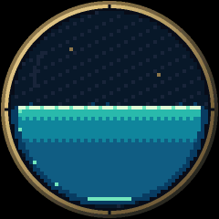

# flip_rp2040 · 像素流体吊坠

面向 **Waveshare RP2040-Touch-LCD-1.28（触摸版）** 的 Pico SDK/C 固件。
从 [原始 FLIP 示例](reference/flip.html) 移植粒子—网格求解流程，支持倾斜重力和触摸扰动。
固件、桌面预览和测试使用同一份定点求解器与渲染器。

水体以 4×4 像素块呈现，色阶随到自由液面的近似距离变化；黄铜圆框在原生 240×240 分辨率下抗锯齿。
2026-11-08 实机默认档测得 **60 FPS / 60 Hz**：CPU 133 MHz，SPI 66.5 MHz，32×32 网格、834 粒子、8 次压力投影。
这是 LCD 传输完成计数，非光学刷新测量；完整数据和限制见 [性能报告](docs/performance.md)。



## 快速开始

推荐使用 VS Code 的 **Raspberry Pi Pico** 扩展（`raspberry-pi.raspberry-pi-pico`）：

1. 用“打开文件夹”打开仓库根目录，安装工作区推荐扩展。
2. 等待 Pico 扩展准备 SDK 并自动配置，点击 **Compile Project**（或 `Ctrl+Shift+B`）。
3. 点击 **Run Project** 通过 USB 烧录运行。首次烧录可按 BOOT + RESET 进入 BOOTSEL。

输出为 `build/flip_rp2040.uf2`；`F5` 的 SWD 调试需要另接 Debug Probe。
完整配置与排错见 [VS Code 使用指南](docs/vscode.md)。
也可直接使用 [交付固件](artifacts/firmware/flip_rp2040.uf2)，或用 `./tools/build.sh` 构建到 `build-pendant/`。

可选桌面预览（需要 SDL2 开发包）：

```bash
cmake -S desktop -B build-desktop -DCMAKE_BUILD_TYPE=Release
cmake --build build-desktop -j
./build-desktop/flip_rp2040_preview
```

预览：左右方向键旋转重力，鼠标左键扰动，`1/2/3` 切换画质，`R` 重置。
实机：倾斜、触摸即可交互，USB 串口 `1/2/3` 切档、`r` 重置、`b` 测量、`u` 进入 BOOTSEL。
回归测试默认关闭，需要时按 [开发指南](docs/development.md) 启用。

## 工程结构

```text
src/            调度、输入、显示、串口、基准、统计；共享求解/渲染/定点数学
include/        模块接口、密度快照格式、单位与所有权约定
lib/            板级 Config / LCD、qmi8658 / cst816 驱动、共用 sensor_i2c
desktop/       独立主机 CMake 入口、SDL 预览与离线动画帧导出
tests/         可选的数值稳定性与渲染回归检查
tools/         固件构建与 USB 串口采集脚本
reference/     原始 FLIP HTML、硬件摘录与资料索引
docs/          开发、架构、硬件、性能与整理记录
artifacts/     唯一交付固件、演示动画、原始测量证据
```

- [架构与算法](docs/architecture.md)：定点单位、求解流程、双核所有权、DMA、渲染缓存。
- [硬件约定](docs/hardware.md)：触摸版引脚、传感器配置、坐标映射。
- [变更记录](CHANGELOG.md)：功能与工程维护记录。
- [第三方来源](NOTICE.md)：参考实现和驱动的许可说明。

这是二维自由表面近似，未实现真实表面张力、三维折射或姿态融合。
高画质档超出 60 Hz 预算时会降低实际物理更新频率；电池续航、长期温升和面板 TE 同步尚未验证。

## 许可证

项目新增代码采用 [MIT License](LICENSE)，第三方版权和许可见 [NOTICE](NOTICE.md)。
