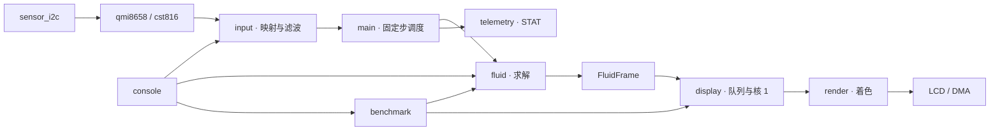

# 架构与算法约定

## 模块与数据流

`main.c` 作为组合入口，只保留板级启动、60 Hz 固定步长调度、输入到网格的坐标换算和快照提交。
模块按下列职责拆分，应用模块的公开接口位于 `include/`，芯片驱动接口位于对应 `lib/` 目录。

| 模块 | 职责与依赖 |
| --- | --- |
| `lib/sensor_i2c/` | 有超时、校验返回长度的寄存器事务；不包含芯片或应用逻辑 |
| `lib/qmi8658/`、`lib/cst816/` | 各自的探测、配置、采样与错误计数；I²C 实例和 GPIO 由调用方提供 |
| `src/input.c` | 组合板上传感器，完成重力轴映射与滤波；触摸输出仍为屏幕像素，不依赖流体网格 |
| `src/display.c` | LCD 初始化、核 1、快照所有权队列、条带与 DMA；只接收 `FluidFrame`，不访问 `Fluid` |
| `src/console.c` | USB 命令分发、档位与坐标设置、诊断输出；基准完成时通知主循环重置调度 |
| `src/benchmark.c` | 九组参数测量、显示发布与统计排空；返回前恢复默认档 |
| `src/telemetry.c` | 两秒统计窗口与 `STAT` 文本协议；只读取传入的运行状态，不操作硬件或队列 |
| `src/fluid.c` | 定点求解与密度快照；不依赖显示或输入服务 |
| `src/render.c` | 从密度快照着色；公开接口独立于求解器 |
| `src/fixed_math.c` | 求解和着色共用的精确整数开方，板端仍放入 SRAM |

`fluid_frame.h` 定义共享的密度格式，`fluid.h` 和 `render.h` 分别定义求解和着色接口。
桌面 CMake 将 `fluid`、`renderer`、`fixed_math` 分开链接；渲染回归不再链接求解器。
桌面预览仍使用与固件相同的源文件。板端计时与 SRAM 段通过 `PICO_ON_DEVICE` 启用，主机不需要 SDK。

板级 `Config` 保留 GPIO、总线和背光的底层初始化；`input`、`display` 在板端作为单实例服务。
这些硬件与单核所有权约束是明确的接口前提，不用通用事件总线或额外整帧缓冲绕开。

## 单位与求解步骤

| 数据 | 单位 / 约定 |
| --- | --- |
| `Particle.x/y` | Q20.12 网格坐标，一格为 4096 |
| `Particle.vx/vy`、网格 `u/v` | 每固定步的位移，同样一格为 4096；不是格/秒 |
| 输入 `gx_mg/gy_mg` | 屏幕坐标的 milli-g，1000 表示 1g；内部限制 ±2500 |
| 触摸位置 | 整数网格坐标；触摸关闭时忽略 |
| 插值权重、密度 | 每粒子总贡献 256；四点权重严格合计 256 |
| `flip` | FLIP 权重 / 256，默认 230（约 90%） |
| 数组布局 | 前 `n*n` 个元素有效，索引 `y*n+x`；最大 n=48 |

每步顺序：积分和圆壁碰撞 → 桶邻域粒子分离及再次碰撞 → 密度累计与 MAC 网格 P2G → 不可压缩投影 → FLIP/PIC G2P。
`u[k]` 位于单元左面，`v[k]` 位于上面；固体相邻面的法向速度归零。
P2G 后保存 `old_u/old_v`，G2P 用投影前后速度差更新 FLIP 分量。

分离只遍历一次无序桶对，用距离查表降低开方开销。投影只遍历 `active` 液体单元，预计算开放面掩码，
全开放单元走简化路径。`weight` 是复用的临时数组：P2G 时是插值权重和，投影时是正密度误差形成的散度目标。
`rest_density=700` 约为 2.73 粒子/格；投影 SOR 系数约为 1.7。

单轴速度限制为 0.75 格/步，保证稳定并限制插值索引范围；强扰动会损失能量，`clipped` 累计 G2P 被限幅的分量数。
求解器不在每步分配内存，热点函数在板端放入 SRAM；分离表首次使用时初始化，因此求解调用必须串行。

调度按 `1/60 s` 固定步推进。运算明显迟到时丢弃过期墙钟调度，并增加 `late`，不放大 dt，
因此高档实际模拟时间可能慢于墙钟。它不是三维液体或完整物理尺度标定模型。

## 双核所有权与 DMA

- 核 0 独占 `Fluid`、IMU、触摸和 USB 命令。初始化显示后，SPI/LCD 交给核 1。
- 核 0 用 `display_acquire_frame()` 借用可写快照，填充后立即 `display_submit_frame()`；提交后禁止继续访问该指针。一次只允许借用一帧，无可用帧时跳过本次发布。
- 每个快照 ID 恰好属于 `free_frames`、核 0、`ready_frames`、核 1 中的一处。
  核 0 只有拿到空闲 ID 才复制密度，无空闲帧则跳过发布。
- 队列各容纳 3 个 ID，总共只有 3 个快照。持有一个 ID 时，目标队列不可能已含 3 个 ID，
  因而发布/归还使用 blocking API 不会因容量不足阻塞。SDK 队列负责跨核同步；不要绕过队列共享可写密度。
- 核 1 取最新快照，逐一归还被跳过的旧快照，持有当前快照直至整帧 DMA 完成。
- 两个条带交替使用：DMA 发送 A 时计算 B，等待上一传输结束后启动 B。
  等待同时检查 DMA 与 SPI 忙状态，防止最后一个 SPI 字仍在发送时切换格式或复用缓冲区。
- 统计队列满时核 1 保留累计值，下一次再尝试发送。BENCH 循环也排空统计，避免退出基准后报告陈旧帧数。

## 像素水体与平滑边框

`FluidFrame` 只复制密度（裁剪到 0–4095），不跨核传递粒子或压力数组。
密度双线性插值决定水体轮廓和浅色浪尖。深度使用容器内部空气为种子，双向 3/4 权重 chamfer 距离传播；
容器壁不作为空气种子。色带表示到自由液面的二维近似距离，随水面变化，不是固定屏幕 Y 坐标或静水压力。

水体默认按 60×60 逻辑像素着色，再放大为 4×4 块。外框用原生 240×240 坐标、2×2 覆盖采样生成，
缓存圆环及其外侧，然后覆盖到每个实体扫描行；它不会随水体逻辑行一起放大。

渲染器有静态深度、采样、行和圆环缓存，不可重入。每张新快照必须从 `y0=0` 开始，然后顺序输出，
整个过程快照保持不变；输出容量至少 `240*rows` 个 16 位元素，行范围必须位于 0–239。

输出为**字节交换后的 RGB565**，继承 Waveshare 字节缓冲区约定。
桌面工具在解释 RGB565 前交换回正常字值；板端 16 位 DMA 开启 byte swap，再由 SPI MSB-first 输出。
修改其中一处需要同步检查另一处，否则会出现颜色错乱。

## 资源与验证边界

最大 `Fluid` 约 108.5 KiB，3 个快照约 13.5 KiB，双条带 7.5 KiB，圆框和深度缓存约 49 KiB。
大对象必须静态分配，不能放在 RP2040 的小栈上。SDK 队列仅在启动时分配；主 SRAM 的具体余量见
[性能报告](performance.md) 第 9 节，不要将早期平滑版本的余量套用于当前版本。

主机回归覆盖守恒、边界、散度、耗散、旋转水深色阶和条带一致性，不能替代 I²C、DMA、显示时序和实际方向检查。
